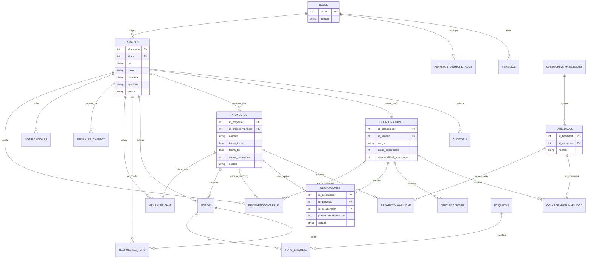

# Documentación de la Base de Datos MySQL — SkillBridge AI

## 1. Información General
* **Motor de Base de Datos:** MySQL 8.4 (AWS RDS en producción / Docker o local)
* **Nombre del Esquema:** `skillbridge_ai`
* **Scripts SQL del repositorio (`src/main/resources/database/`):**
  1. `skillbridge_ai_18_tablas_corregida.sql` — Esquema base (19 tablas).
  2. `actualizacion_colaborador_v3.sql` — Campos adicionales de perfil, foto, certificaciones y notificaciones.
  3. `actualizacion_chatbot_gemini.sql` — Estructura de historial conversacional IA (`mensajes_chatbot`).
  4. `actualizacion_categorias_habilidades.sql` — Catálogo de categorías técnicas (`categorias_habilidades`).
  5. `actualizacion_permisos_roles.sql` — Control dinámico de permisos por rol (`permisos_deshabilitados`).
  6. `actualizacion_recuperacion_contrasena.sql` — Códigos temporales de recuperación (`recuperaciones_contrasena`).
  7. `datos_demo.sql` — Carga inicial de usuarios, roles, proyectos y datos de prueba.

---

## 2. Diagrama Entidad-Relación (ER)

> El modelo editable de MySQL Workbench se encuentra en `src/main/resources/database/tabla_refinada_gtics_v3.mwb`.

---

## 3. Diccionario de Tablas (22 Tablas)

### 3.1. Seguridad, Roles y Auditoría
| Tabla | Clave Primaria (PK) | Claves Foráneas (FK) | Descripción y Campos Principales |
| :--- | :--- | :--- | :--- |
| `roles` | `id_rol` | — | Catálogo de roles (`ADMINISTRADOR`, `PROJECT_MANAGER`, `RESOURCE_MANAGER`, `COLABORADOR`). |
| `permisos` | `id_permiso` | `id_rol` → `roles` | Permisos base asignados a cada rol del sistema. |
| `permisos_deshabilitados` | `id_permiso_deshabilitado` | `id_rol` → `roles` | Registro dinámico de rutas/permisos desactivados por el Administrador en tiempo real. |
| `usuarios` | `id_usuario` | `id_rol` → `roles` | Credenciales (`correo`, `password_hash` con BCrypt), `dni`, `nombres`, `apellidos`, `estado` (`ACTIVO`/`INACTIVO`). |
| `recuperaciones_contrasena` | `id_recuperacion` | — | Códigos temporales de 6 dígitos con fecha de expiración (`expira_en`) para restablecer contraseñas vía correo. |
| `auditoria` | `id_auditoria` | `id_usuario` → `usuarios` | Trazabilidad de acciones críticas (`accion`, `detalle`, `fecha_hora`). |

### 3.2. Talento, Perfiles y Habilidades
| Tabla | Clave Primaria (PK) | Claves Foráneas (FK) | Descripción y Campos Principales |
| :--- | :--- | :--- | :--- |
| `colaboradores` | `id_colaborador` | `id_usuario` → `usuarios` (1:1) | Perfil profesional: `cargo`, `anios_experiencia`, `disponibilidad_porcentaje`, `horas_semanales`, `foto_ruta`, `resumen_profesional`. |
| `categorias_habilidades` | `id_categoria` | — | Agrupación temática de skills (Backend, Frontend, Cloud/DevOps, Datos/IA, etc.). |
| `habilidades` | `id_habilidad` | `id_categoria` → `categorias_habilidades` | Catálogo maestro de habilidades técnicas (`nombre`, `descripcion`). |
| `colaborador_habilidad` | `(id_colaborador, id_habilidad)` | `id_colaborador` → `colaboradores` `id_habilidad` → `habilidades` | Tabla intermedia N:M que guarda el `nivel` (`BASICO`, `INTERMEDIO`, `AVANZADO`, `EXPERTO`) del colaborador. |
| `certificaciones` | `id_certificacion` | `id_colaborador` → `colaboradores` | Certificaciones registradas (`nombre`, `institucion`, `fecha_emision`, `fecha_expiracion`, `credencial_url`). |

### 3.3. Proyectos, Asignaciones e Inteligencia Artificial
| Tabla | Clave Primaria (PK) | Claves Foráneas (FK) | Descripción y Campos Principales |
| :--- | :--- | :--- | :--- |
| `proyectos` | `id_proyecto` | `id_project_manager` → `usuarios` | Proyectos registrados (`nombre`, `descripcion`, `fecha_inicio`, `fecha_fin`, `cupos_requeridos`, `estado`: `PLANNING`, `ACTIVE`, `ON_HOLD`, `COMPLETED`, `CANCELLED`). |
| `proyecto_habilidad` | `(id_proyecto, id_habilidad)` | `id_proyecto` → `proyectos` `id_habilidad` → `habilidades` | Tabla intermedia N:M con las tecnologías requeridas y el `nivel_requerido` por proyecto. |
| `asignaciones` | `id_asignacion` | `id_proyecto` → `proyectos` `id_colaborador` → `colaboradores` | Vinculación formal con `rol_en_proyecto`, `porcentaje_dedicacion` (validado ≤ 100%), `fecha_inicio`, `fecha_fin` y `estado`. |
| `recomendaciones_ia` | `id_recomendacion` | `id_proyecto` → `proyectos` `id_colaborador` → `colaboradores` `solicitado_por` → `usuarios` | Resultados del módulo AI Talent Matching (`puntaje_compatibilidad`, `justificacion_tecnica`, `fecha_generacion`). |

### 3.4. Colaboración, Comunicación y Notificaciones
| Tabla | Clave Primaria (PK) | Claves Foráneas (FK) | Descripción y Campos Principales |
| :--- | :--- | :--- | :--- |
| `foros` | `id_foro` | `id_proyecto` → `proyectos` `id_autor` → `usuarios` | Publicaciones de consulta técnica por proyecto (`titulo`, `contenido`, `resuelto`, `fecha_creacion`). |
| `respuestas_foro` | `id_respuesta` | `id_foro` → `foros` `id_autor` → `usuarios` | Comentarios y respuestas técnicas (`contenido`, `es_solucion`, `fecha_respuesta`). |
| `etiquetas` | `id_etiqueta` | — | Catálogo de tags técnicos (`Java`, `Spring Boot`, `Docker`, `API`, etc.). |
| `foro_etiqueta` | `(id_foro, id_etiqueta)` | `id_foro` → `foros` `id_etiqueta` → `etiquetas` | Tabla intermedia N:M para filtrar hilos de conocimiento histórico por etiquetas. |
| `mensajes_chat` | `id_mensaje` | `id_proyecto` → `proyectos` `id_emisor` → `usuarios` | Historial persistente de salas de chat por proyecto (`contenido`, `fecha_envio`). |
| `mensajes_chatbot` | `id_mensaje_chatbot` | `id_usuario` → `usuarios` | Historial de conversaciones con el asistente Gemini AI (`rol_mensaje`: `USER`/`ASSISTANT`, `contenido`, `fecha_envio`). |
| `notificaciones` | `id_notificacion` | `id_usuario` → `usuarios` | Alertas internas para los colaboradores (`titulo`, `mensaje`, `leida`, `fecha_creacion`). |

---

## 4. Correspondencia entre Tablas MySQL y Entidades JPA (`pe.edu.pucp.skillbridge.entity`)

El backend utiliza Spring Data JPA con `spring.jpa.hibernate.ddl-auto=none`, mapeando las 19 entidades principales y 3 tablas de relación:

| Entidad Java (`entity/*.java`) | Tabla MySQL | Relaciones JPA Implementadas |
| :--- | :--- | :--- |
| `Rol` | `roles` | Entidad catálogo referenciada por `Usuario` y `Permiso`. |
| `Permiso` | `permisos` | `@ManyToOne` hacia `Rol`. |
| `PermisoDeshabilitado` | `permisos_deshabilitados` | `@ManyToOne` hacia `Rol`. |
| `Usuario` | `usuarios` | `@ManyToOne` hacia `Rol`. |
| `RecuperacionContrasena` | `recuperaciones_contrasena` | Entidad independiente vinculada por correo institucional. |
| `Auditoria` | `auditoria` | `@ManyToOne` hacia `Usuario`. |
| `Colaborador` | `colaboradores` | `@OneToOne` hacia `Usuario`. |
| `CategoriaHabilidad` | `categorias_habilidades` | Entidad catálogo de categorías técnicas. |
| `Habilidad` | `habilidades` | Vinculada a `CategoriaHabilidad` y tablas intermedias. |
| `Certificacion` | `certificaciones` | `@ManyToOne` hacia `Colaborador`. |
| `Proyecto` | `proyectos` | `@ManyToOne` hacia `Usuario` (Project Manager). |
| `Asignacion` | `asignaciones` | `@ManyToOne` hacia `Proyecto` y `@ManyToOne` hacia `Colaborador`. |
| `RecomendacionIA` | `recomendaciones_ia` | `@ManyToOne` hacia `Proyecto`, `Colaborador` y `Usuario`. |
| `Foro` | `foros` | `@ManyToOne` hacia `Proyecto` y `@ManyToOne` hacia `Usuario`. |
| `RespuestaForo` | `respuestas_foro` | `@ManyToOne` hacia `Foro` y `@ManyToOne` hacia `Usuario`. |
| `Etiqueta` | `etiquetas` | Entidad catálogo de tags de foro. |
| `MensajeChat` | `mensajes_chat` | `@ManyToOne` hacia `Proyecto` y `@ManyToOne` hacia `Usuario`. |
| `MensajeChatbot` | `mensajes_chatbot` | `@ManyToOne` hacia `Usuario`. |
| `Notificacion` | `notificaciones` | `@ManyToOne` hacia `Usuario`. |
| *(Consultas nativas / Repositorios)* | `colaborador_habilidad` `proyecto_habilidad` `foro_etiqueta` | Tablas asociativas N:M gestionadas directamente mediante consultas SQL en los repositorios JPA. |